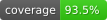
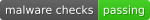

# Tweaks for LinkedIn (unofficial)

A small Chrome extension for a calmer LinkedIn. Hide the clutter, give your feed more room, and choose whose posts and suggestions you see.

> **Unofficial.** Not affiliated with, endorsed by, or supported by LinkedIn. LinkedIn is a trademark of LinkedIn Corporation.

> **Use at your own risk.** LinkedIn's [User Agreement](https://www.linkedin.com/legal/user-agreement) and [rules on browser extensions](https://www.linkedin.com/help/linkedin/answer/a1341387) do not allow tools that change how the site looks or remove ads, and LinkedIn can restrict or close accounts that break them. This applies to every tweak here. If your LinkedIn account is important to you, weigh that before installing.

## Features

**Clean up every tab**
- Hide the promoted banner in the side column.
- Hide the footer links.
- Hide *Today's puzzles*.
- Hide Premium promos.
- Hide the floating Messaging bar. A conversation you open from someone's profile still appears.

**More room for what you read**
- **Widen the feed**: on Home, the feed takes over the empty right column.
- **Same width on all tabs**: Network, Jobs, and Notifications line up with Home, and Messaging uses the full width.

**Choose whose posts you see**
- Separate switches for posts from **1st**, **2nd**, and **3rd+ connections**, and from **everyone else** (companies, people you follow, and posts with no connection label).
- For example, to see only your 1st connections, turn the other three off.
- After 10 hidden posts in a row, one stays visible but dimmed, so LinkedIn doesn't keep loading more while you scroll.

**Hide people from your own company**
- On *My Network → Grow*, hide suggested people whose headline names your company.
- Type your company in the extension's popup, one name per line, up to 10 names. Add variants if people write it differently.
- Capital letters and accents don't matter, so `Skoda` also finds `Škoda`.
- Past jobs stay visible, such as `ex-Acme` or `Former Engineer at Acme`.
- Your company names are saved only in this browser.

**Block promoted posts** (optional, off by default)
- Hides promoted posts in your Home feed as they load.
- A counter in the popup shows how many were blocked on the page.
- Recognizes the "Promoted" label in English and other EU languages.
- It's off by default because removing ads carries the most risk for your account.

## Settings

Click the **Tweaks for LinkedIn icon** in the Chrome toolbar. If you don't see it, pin it from the puzzle-piece menu. The icon is **blue on LinkedIn tabs**, where the extension is working, and **grey on other websites**.

| Tab | Setting | Default |
|---|---|---|
| Everywhere | Hide promoted banner | On |
| Everywhere | Hide footer links | On |
| Everywhere | Hide Today's puzzles | On |
| Everywhere | Hide Premium promos | On |
| Everywhere | Hide floating Messaging bar | On |
| Everywhere | Same width on all tabs | On |
| Home | Block promoted | **Off** |
| Home | Show 1st connections | On |
| Home | Show 2nd connections | On |
| Home | Show 3rd+ connections | On |
| Home | Show everyone else | On |
| Home | Hide Add to your feed | On |
| Home | Widen the feed | On |
| Network | Hide people at my company (+ your list of names) | On, hides nothing until you add a name |

Changes apply right away to open LinkedIn tabs. Your switches sync with your Chrome profile.

*Same width on all tabs* needs the banner and footer hidden. *Widen the feed* also needs puzzles and *Add to your feed* hidden. If one of those is showing, the width switch is grayed out.

**Feedback or report a problem**, at the bottom of the popup, opens a form on GitHub with the extension version, Chrome version, and language filled in. You can see and edit everything, and nothing is sent unless you submit it.

## Installation

The extension isn't in the Chrome Web Store, so you install it by hand. It takes about a minute and needs Chrome 111 or newer.

1. Download the `tweaks-for-linkedin` ZIP from the [latest release](https://github.com/VatslauX/tweaks-for-linkedin/releases/latest).
2. Unzip it into a folder you'll keep. Chrome loads the extension from there, so don't delete it.
3. Open `chrome://extensions` and turn on **Developer mode** (top right).
4. Click **Load unpacked** and choose the unzipped folder.
5. Pin the extension from the puzzle-piece menu.

**To update:** Chrome won't update it for you. Unzip the new version over the same folder, then click the reload icon on the extension's card in `chrome://extensions`. Your settings stay.

**To remove:** click **Remove** on the extension's card. LinkedIn goes back to normal, and your saved settings and company names are deleted.

## Privacy & safety

- Runs only on `https://www.linkedin.com/`. Its only permission is `storage`, for your settings.
- Nothing is sent anywhere. There is no server, account, analytics, or remote code.
- It never clicks, likes, follows, posts, or sends anything on LinkedIn, and it doesn't load extra profiles or data.
- To apply the filters, it compares a few short pieces of text already on the page: the labels on feed posts and the headlines of suggested people. This happens in memory, and the text is never saved.
- **LinkedIn can tell it's there.** The extension adds small markers to the page, and LinkedIn can also notice hidden blocks and changed widths. The extension doesn't try to hide itself.

See [PRIVACY.md](PRIVACY.md) for exactly what it reads and stores.

## Notes & limitations

- LinkedIn changes its pages often, so a tweak can stop working without notice.
- The layout has been checked on real LinkedIn only in a window about 1018 px wide. Other sizes may look different.
- The connection filter works with LinkedIn in English. How it treats reposts hasn't been confirmed.
- Only the English "Promoted" label has been seen on real LinkedIn. Other languages are untested, and some labels have a second meaning (Hungarian "Kiemelt" also means "Featured"), so a normal post could be hidden.
- With *Block promoted* on, a promoted post can flash briefly while the page loads.
- The company filter only knows what a headline says. Colleagues who don't mention the company stay visible, and a similar name can match (`Acme` also matches `Acme Partners`).
- Past-job wording such as "ex-" and "former" is recognized in English only.
- The company filter hasn't been checked with invitation cards. If you're expecting an invitation from a colleague and don't see it, turn the filter off.
- Opening a chat from a profile with the Messaging bar hidden has been tested only on a mock page.
- Promoted jobs, *For Business*, *Advertise*, and *Post a free job* are not hidden.

Found a problem or have an idea? Use **Feedback or report a problem** in the popup, or [open the form here](https://github.com/VatslauX/tweaks-for-linkedin/issues/new/choose). Issues are public, so please don't include LinkedIn HTML or screenshots of real people.

See [CHANGELOG.md](CHANGELOG.md) for release notes.

## License

[Apache License 2.0](LICENSE). See also [NOTICE](NOTICE). LinkedIn is a trademark of LinkedIn Corporation, and this project is not affiliated with it.
